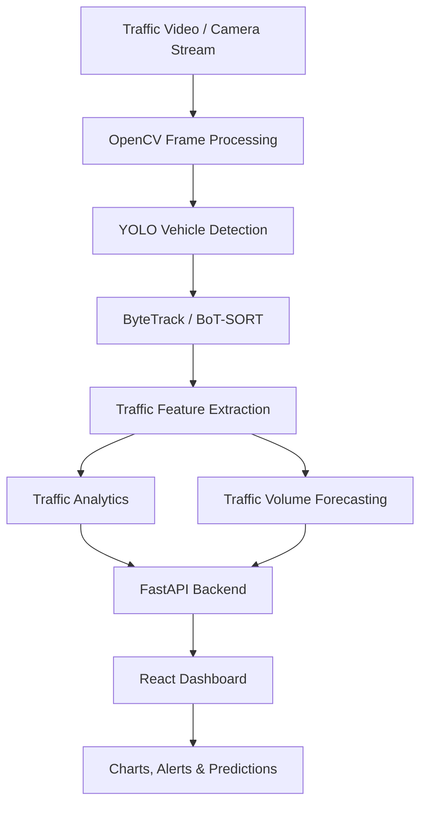

🚦 TrafficMind — Smart Traffic Analytics & Prediction
 
An AI-powered traffic intelligence platform for vehicle detection, multi-object tracking, congestion monitoring, and short-term traffic forecasting.

TrafficMind combines computer vision, machine learning, and interactive analytics to transform traffic footage into actionable insights for smarter traffic management.

«Project Status: In Development 🚧»
 ```mermaid
"Python" (https://img.shields.io/badge/Python-3776AB?style=for-the-badge&logo=python&logoColor=white)
"React" (https://img.shields.io/badge/React-20232A?style=for-the-badge&logo=react&logoColor=61DAFB)
"FastAPI" (https://img.shields.io/badge/FastAPI-009688?style=for-the-badge&logo=fastapi&logoColor=white)
"YOLO" (https://img.shields.io/badge/YOLO-Computer_Vision-8A2BE2?style=for-the-badge)
"Status" (https://img.shields.io/badge/Status-In_Development-orange?style=for-the-badge)
```

✨ Key Features

- 🚗 Vehicle Detection: Detect cars, motorcycles, buses, and trucks using YOLO.
- 🎯 Object Tracking: Track vehicles across video frames with persistent tracking IDs using ByteTrack or BoT-SORT.
- 📊 Traffic Analytics: Visualize vehicle counts, traffic volume, vehicle categories, and peak traffic periods.
- 🚥 Congestion Detection: Estimate traffic density and identify potentially congested areas.
- 🔮 Traffic Forecasting: Predict upcoming traffic volume using historical counts and machine learning.
- 🗺️ Congestion Map: Visualize camera locations and congestion levels.
- 🔔 Smart Alerts: Highlight unusual traffic patterns and congestion threshold events.
- 📈 Interactive Dashboard: Explore traffic insights through charts, metrics, and monitoring panels.

🖥️ Dashboard Modules

Module| Description
Overview| Traffic KPIs, recent alerts, and traffic trends
Live Monitoring| Video playback, vehicle detection, and tracking
Analytics| Traffic volume, vehicle distribution, and peak-hour analysis
Predictions| Short-term traffic volume forecasting
Congestion Map| Camera locations and congestion visualization
Alerts & Incidents| Traffic events and severity management
System Management| Camera status and ML model configuration

🧠 Machine Learning Pipeline

1. Video Input: Load an uploaded traffic video or a supported camera stream.
2. Preprocessing: Read video frames using OpenCV.
3. Detection: Run YOLO inference to detect and classify vehicles.
4. Tracking: Associate detections across frames using ByteTrack or BoT-SORT.
5. Traffic Analytics: Aggregate vehicle counts, movement, and density over time.
6. Forecasting: Use historical traffic features to predict upcoming traffic volume.
7. Visualization: Deliver processed results to the dashboard through a FastAPI backend.

🛠️ Tech Stack

Frontend

- React
- TypeScript
- Vite
- Tailwind CSS
- shadcn/ui
- Recharts
- React Router
- Lucide Icons

Backend & Machine Learning

- Python
- FastAPI
- OpenCV
- Ultralytics YOLO
- ByteTrack / BoT-SORT
- Scikit-learn
- XGBoost
- Pandas and NumPy

Visualization & Deployment

- Leaflet
- OpenStreetMap
- Docker (planned or optional)

🏗️ Architecture

TrafficMind processes traffic footage through a computer vision pipeline and delivers traffic insights through an interactive dashboard.



Processing Pipeline

1. Video Input: Upload a traffic video or connect a supported camera stream.
2. Frame Processing: OpenCV reads and prepares video frames.
3. Vehicle Detection: YOLO detects cars, motorcycles, buses, and trucks.
4. Object Tracking: ByteTrack or BoT-SORT tracks vehicles across frames.
5. Feature Extraction: Calculate vehicle counts, traffic volume, and density.
6. Analytics & Forecasting: Analyze traffic patterns and forecast future vehicle volume.
7. Dashboard: FastAPI delivers processed results to the React frontend.

```text
📁 Project Structure

TrafficMind/
├── frontend/
│   ├── public/
│   ├── src/
│   │   ├── components/
│   │   ├── pages/
│   │   ├── services/
│   │   ├── hooks/
│   │   ├── types/
│   │   ├── App.tsx
│   │   └── main.tsx
│   ├── index.html
│   ├── package.json
│   ├── tsconfig.json
│   └── vite.config.ts
│
├── backend/
│   ├── app/
│   │   ├── routes/
│   │   ├── services/
│   │   ├── models/
│   │   ├── schemas/
│   │   └── main.py
│   └── requirements.txt
│
├── data/
├── models/
├── tests/
├── assets/
├── .env.example
├── .gitignore
└── README.md
```

📂 Directory Description

Directory| Purpose
"frontend/src/components/"| Reusable UI components, cards, charts, and tables
"frontend/src/pages/"| Dashboard, live monitoring, analytics, and prediction pages
"frontend/src/services/"| API calls and backend integration
"frontend/src/hooks/"| Reusable React hooks
"frontend/src/types/"| TypeScript interfaces and type definitions
"backend/app/routes/"| FastAPI endpoints
"backend/app/services/"| Video processing and traffic analysis logic
"backend/app/models/"| ML inference and forecasting modules
"backend/app/schemas/"| API request and response schemas
"data/"| Dataset instructions or locally stored sample data
"models/"| Model configuration and locally stored model files
"tests/"| Automated tests
"assets/"| Screenshots, diagrams, and demo images

«Note: This is the proposed project structure. Create these directories as you implement the application, and keep the README consistent with the actual repository contents.»

🚀 Getting Started

Prerequisites

- Node.js and npm
- Python 3.10 or a compatible version supported by your selected ML dependencies
- Git
- A webcam or sample traffic video for testing
- Optional: NVIDIA GPU with compatible drivers and CUDA for accelerated inference

1. Clone the Repository

git clone https://github.com/vtomar2007-byte/TrafficMind.git
cd TrafficMind

2. Start the Frontend

cd frontend
npm install
npm run dev

Open the local URL displayed by Vite in your terminal.

3. Set Up the Backend

Open another terminal:

cd backend
python -m venv .venv

Activate the environment.

Windows PowerShell

.\.venv\Scripts\Activate.ps1

macOS / Linux

source .venv/bin/activate

Install the backend dependencies:

pip install -r requirements.txt

Start FastAPI:

uvicorn app.main:app --reload

If configured, the API documentation will be available at:

http://127.0.0.1:8000/docs

These commands assume the corresponding files and endpoints have been implemented.

📊 Model Evaluation

TrafficMind should be evaluated using metrics appropriate to each task.

Task| Suggested Metrics
Vehicle Detection| Precision, Recall, mAP@50, mAP@50–95
Vehicle Tracking| HOTA, IDF1, ID switches
Traffic Forecasting| MAE, RMSE, MAPE where appropriate
Congestion Classification| Precision, Recall, F1-score, confusion matrix
System Performance| FPS, inference latency, processing throughput

🔮 Roadmap

- [x] Project concept and system architecture
- [ ] Responsive multi-page dashboard
- [ ] YOLO vehicle detection integration
- [ ] Persistent vehicle tracking
- [ ] Vehicle counting and traffic analytics
- [ ] Congestion detection
- [ ] Short-term traffic forecasting
- [ ] Interactive congestion map
- [ ] FastAPI integration and testing
- [ ] Docker deployment
- [ ] Model evaluation and performance optimization

Update these checkboxes as features are actually completed.

🔐 Responsible Use

- Use authorized traffic footage and camera feeds.
- Avoid collecting or storing unnecessary personal information.
- Do not treat model predictions as guaranteed outcomes.
- Clearly distinguish demo data from real measurements and model outputs.

🤝 Contributing

Contributions, bug reports, feature suggestions, and improvements are welcome.

1. Fork the repository.
2. Create a feature branch.
3. Commit your changes.
4. Open a pull request describing the improvement.

📄 License

MIT License — choosealicense.com⁠. All rights remain with the copyright holder.

👨‍💻 Author

Vivek Tomar 

- GitHub: "vtomar2007-byte" (https://github.com/vtomar2007-byte)
- LinkedIn: www.linkedin.com/in/vivek-tomar-1957bb359


---

TrafficMind — Turning Traffic Data into Intelligent Decisions. 🚦
